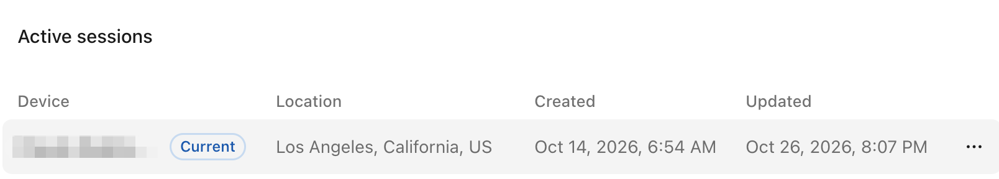
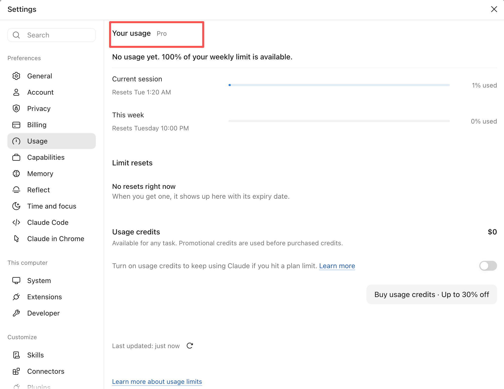

<h1>&nbsp; Claude Access for All</h1>

**Frontier intelligence should serve humanity, in every corner of the world.**

An open, English-language field guide and local toolkit for accessing Claude Code on macOS: subscription choices, network reliability, billing hygiene, account security, and recovery.

## Why this exists

The next great scientific idea may come from a student with an aging laptop. The next useful piece of software may begin in a small town, far from a technology hub. Talent is everywhere. Access to the tools that multiply it is still uneven.

We believe AI should benefit all of humanity. The ability to learn, build, and participate in the future should reach people across borders, languages, and economic circumstances. That includes developers in corners of the world where access is currently restricted, communities overlooked by product rollouts, and people for whom a failed subscription is a meaningful financial loss.

Claude Code is the starting point for this project because we want more people to experience frontier AI in their daily work. Our ambition is a world where the best available models are within everyone's reach. We treat that as a mission, not a permanent benchmark ranking for any single model or company.

Open knowledge can reduce confusion, expose misleading promises, help people protect their money and accounts, and make barriers visible to the people who can remove them. We hope this repository becomes a small piece of that shared infrastructure.

## Start here

1. Read [availability and access paths](docs/availability.md) before spending money.
2. Follow the [macOS quickstart](docs/macos-quickstart.md).
3. Choose and manage a plan with the [subscription playbook](docs/subscriptions.md).
4. Diagnose connectivity with the [network and “clean IP” guide](docs/network.md).
5. Protect your account with the [account continuity guide](docs/account-continuity.md).
6. Review the [client privacy inspector](docs/privacy-inspector.md) for CLI, Desktop, and web.
7. Use the [troubleshooting decision table](docs/troubleshooting.md) when something breaks.

## What you get

| Area | Practical outcome |
| --- | --- |
| macOS setup | Install, authenticate, and verify your billing route |
| Network reliability | Separate proxy, TLS, service, and account problems |
| Subscription management | Record billing ownership and review renewals |
| Account continuity | Secure access, preserve work, and prepare an appeal |
| Local tools | Offline diagnostics, scoped launchers, browser signal inspector, and calendar reminder |
| Evidence | Dated official sources and a contribution standard |

## Session location example

An example of an account's active-session view showing a reported location:



The displayed location is provided by the service. A process timezone setting alone does not change the network exit IP or guarantee a particular session location.

## Claude Pro subscription example

An example of the Claude Desktop usage screen after subscribing to Pro:



Plan availability and usage limits depend on your account and the provider's current terms.

## Install and run

Requires macOS, Node.js 18+, Python 3.9+, and Git for the GitHub install. Install Claude Code or Claude Desktop separately when needed. Install the CLI from the npm registry or directly from GitHub.

Run the interactive menu without a permanent install:

```sh
npx --yes claude-access-for-all
```

Or install the command globally:

```sh
npm install -g claude-access-for-all
claude-access
```

## Command reference

Run `claude-access` without arguments to open the interactive menu, or use a command directly:

| Command | What it does |
| --- | --- |
| `claude-access` or `claude-access menu` | Open the interactive menu for diagnostics, launching clients, and reminders. |
| `claude-access score` | Score the current terminal's timezone and UTC offset using a partial, offline heuristic. Browser-only signals are not measured. |
| `claude-access doctor` | Check the system, Claude Code installation, and whether common environment variables are set. |
| `claude-access audit` | Inspect the current terminal's timezone names and whether locale, proxy, endpoint, and authentication variables are set. |
| `claude-access cli` | Launch Claude Code with process-scoped settings, requesting the Los Angeles timezone by default. |
| `claude-access app` | Request a new Claude Desktop instance with process-scoped settings and the Los Angeles timezone by default. |
| `claude-access desktop-shortcut` | Create a standalone macOS launcher in the current directory that requests the same Desktop settings. |
| `claude-access web` | Open Claude in a separate Chrome profile, requesting the Los Angeles timezone by default; use `--browser edge` for Microsoft Edge. |
| `claude-access inspect` | Open the local browser signal inspector in the default browser. |
| `claude-access reminder --renewal YYYY-MM-DD` | Print a one-time renewal-review calendar event. Redirect the output to an `.ics` file and import it into Calendar. |
| `claude-access guide` | Open the English privacy and access guide. |
| `claude-access help` | Show the command list and examples. |
| `claude-access version` | Show the installed package version. |

The score is not a complete browser score, a ban prediction, or an eligibility check. Desktop and browsers may not honor the requested timezone. For available options, run a supported subcommand with `--help`, such as `claude-access web --help`.

## Open Claude from the Dock

Run `claude-access desktop-shortcut` to create `Claude Access Launcher.app` in the current directory. Quit Claude first, then double-click the launcher. Drag the launcher to the Dock for future launches; after Claude opens, use Command-Tab to switch to it as usual. The launcher is a separate app, and does not replace or modify Claude. An existing Claude instance may reuse state or services; the launcher cannot change an already-running process. It requests the Los Angeles timezone and English locale, but Claude or its services may read system settings independently. No change to network routing or account eligibility is made.

Run `claude-access desktop-shortcut --help` to select a different output path, timezone, or locale. The launcher refuses to overwrite an existing path. To remove it, quit it and delete its `.app` bundle.

## Examples


```sh
claude-access doctor
claude-access audit
claude-access score
claude-access cli --timezone America/Los_Angeles
claude-access app --timezone America/Los_Angeles
claude-access web --browser chrome --timezone America/Los_Angeles
claude-access inspect
claude-access reminder --renewal 2026-12-01 --days-before 3 > renewal.ics
open renewal.ics
```

To install directly from GitHub, use `npm install -g github:AMark-CS/claude-access-for-all`. Use `claude-access help` to see the complete command list. Diagnostics display a readable summary by default. `inspect` opens the local graphical browser inspector in your default browser. To check a separate browser profile, open its local file in that profile instead; see the [privacy inspector guide](docs/privacy-inspector.md).

For the calendar reminder, replace the example date with the next billing date shown by your billing provider. The file contains one all-day review event with an alert; import it into Apple Calendar and check your notification settings. It neither cancels nor renews anything, and must be regenerated when the billing date changes.

The diagnostics run offline and do not print environment-variable values. The `score` command uses the third-party reference weights for timezone and UTC offset only, with its partial denominator and unmeasured browser signals clearly labeled; it is not a ban prediction. Scoped launchers default to the Los Angeles timezone. The scoped launchers request process-local timezone and language settings; Desktop and browsers may behave differently. The browser launcher opens Claude in a separate profile and prints its private data directory. Review the [privacy guide](docs/privacy-inspector.md) for limitations before use.

To run the source version directly without npm, use `python3 tools/access.py doctor` or `python3 tools/privacy.py audit` from a clone. Review the short [source](tools/access.py) before running it.

## Honest boundaries

Anthropic currently limits availability by location. A working connection or successful payment does not establish eligibility. This project cannot grant access, reverse a suspension, or guarantee that an account stays active. See the [official availability list](https://support.claude.com/en/articles/8461763-where-can-i-access-claude).

We document practical access issues and advocate broader availability. We do not sell accounts, proxy subscriptions, credentials, or guarantees of immunity from account review. No VPN vendor, IP reputation score, or “account warming” ritual is endorsed as a solution to eligibility restrictions.

## Help build this

Contribute a reproducible fix, a clearer explanation, an accessibility improvement, or a dated policy correction. Please read [CONTRIBUTING.md](CONTRIBUTING.md), the [evidence register](docs/sources.md), and [SECURITY.md](SECURITY.md) first. Never put account identifiers, IP addresses, receipts, tokens, or payment details in public issues.

Potential next steps: a macOS menu bar companion, additional billing-provider walkthroughs, and a structured history of access barriers. These are roadmap ideas.

Independent community project. Not affiliated with or endorsed by Anthropic. Claude and Claude Code are their respective owners' trademarks. MIT licensed. Official sources last reviewed **October 27, 2026**; recheck them before purchasing.
